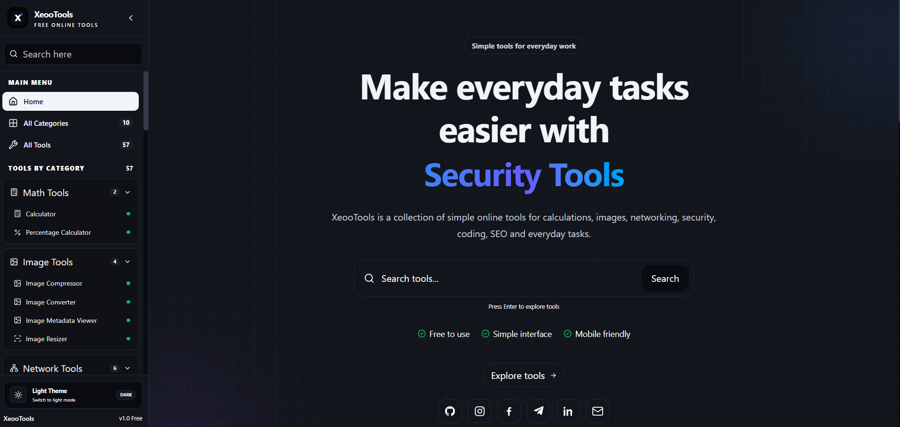

# 🛠️ XeooTools

  

  
  
  
  

  <strong>One Platform. Countless Possibilities.</strong>
   
  A modern collection of free online utilities for developers, creators, designers, and everyday digital tasks.

  

  
  
  
  
  
  

---

## ✨ Discover XeooTools

**XeooTools** is an open-source, all-in-one web utility and developer toolkit designed to simplify digital workflows.

From development, SEO, and cybersecurity training to file manipulation, image processing, networking, psychology, health, and productivity, XeooTools unites high-utility tools under a single, cohesive, modern interface.

  <a href="https://xeootools.site.je/">
    <strong>🚀 Launch XeooTools Live Platform →</strong>
  </a>

### ⚡ Built Around What You Need

<table>
  <tr>
    <td align="center" width="25%">
      <h3>⚡</h3>
      <strong>Fast & Practical</strong>
       
      Utilities engineered to simplify tasks with minimal friction and zero bloat.
    </td>
    <td align="center" width="25%">
      <h3>🎨</h3>
      <strong>Clean & Responsive</strong>
       
      Consistent UI design with full responsiveness and seamless Light/Dark modes.
    </td>
    <td align="center" width="25%">
      <h3>🔒</h3>
      <strong>Privacy Conscious</strong>
       
      Client-side processing where practical; your files remain in your browser.
    </td>
    <td align="center" width="25%">
      <h3>🛡️</h3>
      <strong>Security Hardened</strong>
       
      OWASP Top 10 aligned: Anti-CSRF tokens, brute-force rate limiting, and secure cookies.
    </td>
  </tr>
</table>

---

## 🧭 Tool Categories Overview

XeooTools provides a modular categorization system designed to make utilities easy to discover:

- **🔢 Math Tools**: Scientific calculations, percentages, fractions, prime analysis, algebraic solvers, and geometry calculations.
- **📁 File Tools**: Browser-based file compression, encryption/decryption, splitting, merging, hash analysis, and metadata inspection.
- **🖼️ Image Tools**: Client-side format conversion (WebP, PNG, JPEG, AVIF), resizing, compression, and EXIF metadata viewers.
- **🌐 Network Tools**: Domain diagnostics, IP lookups, reverse IP resolvers, scam link verifiers, and exposure scanners.
- **🛡️ Security Tools**: Cryptographic hashing, hash identification, password generation and strength auditing, UUIDs, and JWT decoding.
- **🤖 AI Tools**: Prompt optimization, template builders, token estimation, model parameter exploration, and cost calculators.
- **🎨 Design Tools**: Color palettes, CSS code generators, glassmorphism, gradient creators, typography scales, and contrast checkers.
- **🔍 SEO Tools**: Meta tag analyzers, SERP previews, robots.txt and sitemap builders, backlink verifiers, and domain authority checkers.
- **🧠 Psychology Tools**: Structured self-reflection, personality assessments, stress level tests, and cognitive exploration *(disajikan dalam Bahasa Indonesia)*.
- **🩺 Health Tools**: Daily health metrics tracking, BMI calculators, macronutrient estimators, heart rate zones, and sleep cycle tools.
- **🏴 Defacement & CTF Lab**: Authorized security training playground with interactive challenges, page generators, and leaderboard tracking.
- **⚡ Productivity Tools**: Interactive typing speed and accuracy testing, dynamic barcode and QR code generators.
- **⚙️ Admin Dashboard**: Centralized operations portal for managing tool statuses, category visibility, user reports, and platform settings.

---

## 🧰 Powered By

  
  &nbsp;
  
  &nbsp;
  
  &nbsp;
  
  &nbsp;
  
  &nbsp;
  

- **Frontend**: React 19, TypeScript, Vite, React Router v7, Tailwind CSS v4, Lucide React, Motion
- **Backend**: PHP 8.4, PDO Prepared Statements, MySQL 8.0, Apache Server
- **Security**: Anti-CSRF protection, IP rate limiting, strict cookie policies, OWASP security headers

---

## 🔐 Security & Privacy

XeooTools prioritizes responsible engineering and user privacy:

- **Client-Side Processing**: Supported file and image utilities process data directly in your browser without uploading to external servers.
- **Hardened Backend**: Protected against brute-force attacks, CSRF forgery, and directory traversal.
- **Safe Testing Ground**: Security and diagnostic tools are strictly built for authorized assessments and educational analysis.

---

## 📄 License

XeooTools is open-source software licensed under the **[MIT License](LICENSE)**.

---

  
    
  
    
  Made with 🛠️ for developers, creators, and curious minds.

